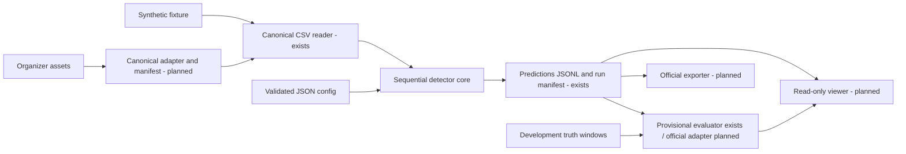
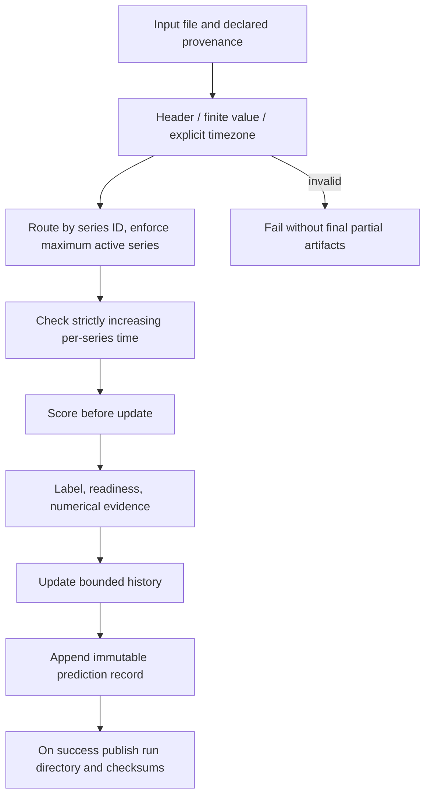
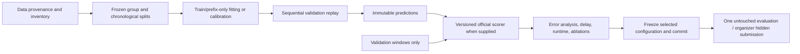
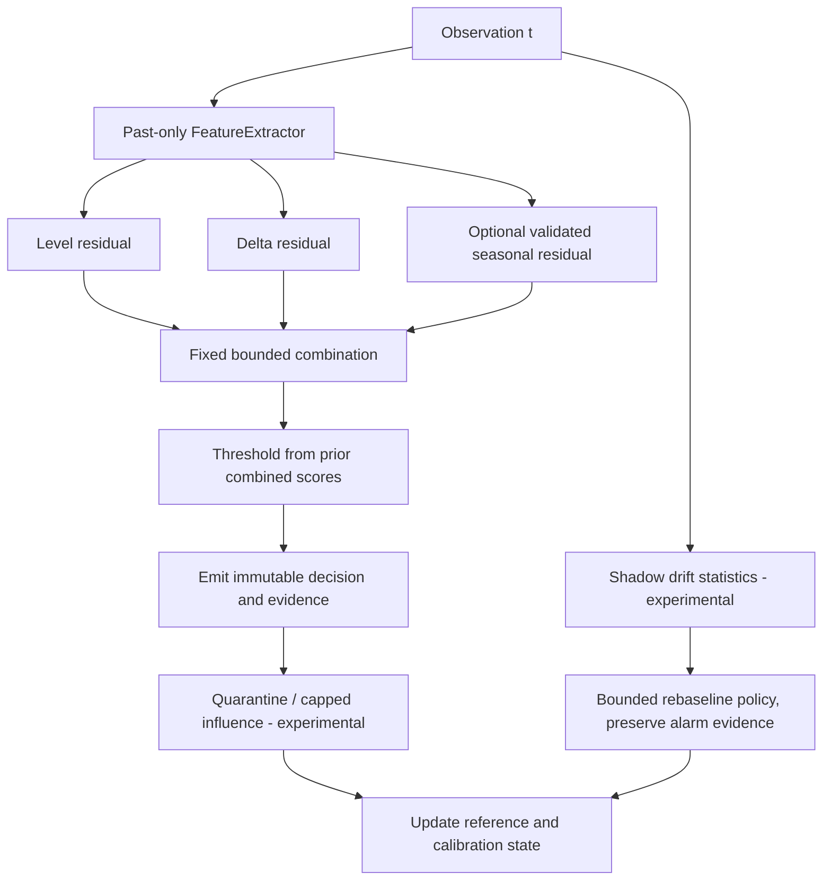
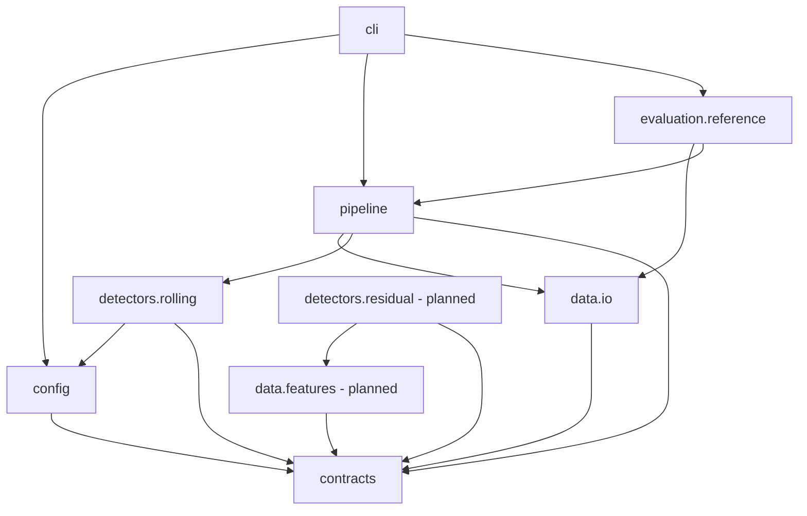
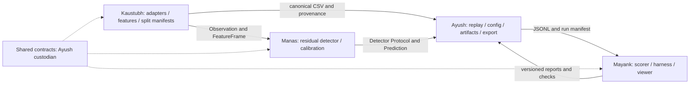

# Architecture blueprint

Design status: baseline path implemented; residual/calibration/adaptation/persistence/viewer are
planned. [INTERFACES](INTERFACES.md) and [DECISIONS](DECISIONS.md) define compatibility. All state
and features are local to a series; no centered/future-aware transforms or label-fed inference.

## 1. Overall architecture

The core imports no UI or evaluator. The evaluator reads saved predictions and separate truth.
Labels cannot enter the typed detector input. The viewer can fail without invalidating inference.

## 2. Processing and data flow

No resampling/imputation occurs silently. Kaustubh will implement explicit gap/missing policies
when dataset semantics are known. The starter rejects malformed rows instead of inventing values.
Routing is interleaving-safe; each series must be internally ordered. No automatic sorting of an
entire evaluation stream, which would mask upstream ordering errors.

## 3. Training and evaluation flow

The starter has no offline trainer; rolling learning occurs inside `process`. A future fitted
comparator must expose its training prefix manifest and begin evaluation without test fitting.
Calibration and unsupervised online updates use only permitted previous observations. Do not
assume organizer rules permit every update policy; record Q08 resolution first.

## 4. Intended inference flow

Starter instead uses `RollingMADStarter` directly: median of the last W values, scale
max(1.4826*MAD, floor), absolute standardized deviation, fixed threshold, then append the value.
It includes anomalous values in history and will eventually absorb persistent shifts. It has
no seasonal, empirical-threshold, quarantine, or shadow logic. That limitation is deliberate.

Level B proposal: start level/delta scores with a shared robust scale; combine by max, calibrate
the combined score using only the preceding score buffer, and test seasonal residuals separately.
Minimum quantile history and fallback must be fixed in config. A guard cannot discard data forever:
compare capped influence, finite quarantine, and an explicitly tested shadow model. Do not claim
formal alarm-rate guarantees under serial dependence or selective updates.

## 5. Module dependency graph

Evaluation currently imports only the pipeline checksum helper, not the detector execution path.
Move common artifact helpers to an owned utility if a later change warrants it; do not introduce
an abstraction solely to remove one harmless dependency. UI/experiments remain leaf consumers.

## 6. Team integration boundaries

## Lifecycle, complexity, and deployment

One detector/extractor instance handles one series, starts empty, and may reset explicitly.
Histories are bounded by configuration. Core memory is O(SW) for S active series; median/MAD
recomputation is O(W log W) per point. With seasonal horizon H and calibration buffer C, planned
state is O(S(W+H+C)). Exact time depends on implementations and must be measured. The evaluator
holds truth windows and per-series coverage/matches; it streams JSONL and does not retain full
predictions. Reference matching scans truth windows per episode and is not the final optimized scorer.

Persistence task AY-02 will add versioned validated JSON state, config/data-cursor compatibility,
last timestamp, and replay-parity tests. Until then, recovery is a complete deterministic replay;
no `--resume` functionality exists. Models with external fit artifacts need their own reviewed
serialization contract. JSON files do not contain executable pickle objects.

Run locally with the CLI and package install. CI validates the package; no Docker, API server,
database, orchestration platform, or cloud deployment is required. A read-only local HTML viewer
is optional and consumes immutable artifacts. Inference uses no wall-clock sleeps to simulate
streaming: cadence comes from timestamps; replay speed is measured separately.
